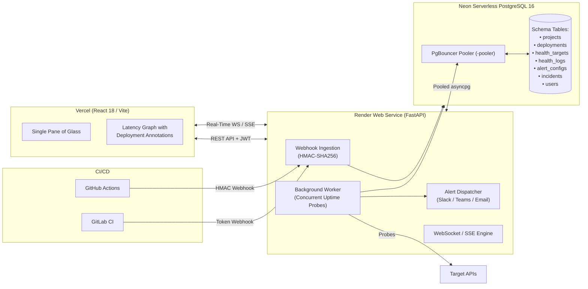

# PulseOps | Deployment & Application Health Monitoring Platform

[](https://neon.tech)
[](https://fastapi.tiangolo.com)
[](https://react.dev)
[](https://render.com)

**PulseOps** is a lightweight, production-ready Deployment & Application Health Monitoring Platform tailored for 5–20 projects across 4 environments (`development`, `testing`, `staging`, `production`).

The platform ingests deployment events from GitHub Actions and GitLab CI/CD via cryptographically verified webhooks, monitors application uptime and latency with non-blocking async probes, visualizes release timelines overlaid on latency graphs, and dispatches failure/recovery notifications to Slack, Microsoft Teams, Email, and Webhooks.

---

## 🌟 Key Capabilities

- **Single Pane of Glass Dashboard:** Overview cards for 5–20 microservices displaying live health status (`UP`, `DOWN`, `DEGRADED`), p95 response time, active incidents, and latest deployment status.
- **CI/CD Webhook Ingestion Engine:**
  - GitHub Actions validation with HMAC-SHA256 (`X-Hub-Signature-256`).
  - GitLab CI/CD validation with secret tokens (`X-Gitlab-Token`).
  - Rejection and logging of unverified payloads with HTTP 401.
- **Non-Blocking Background Uptime Worker:**
  - Asynchronous concurrent HTTP probing loop powered by `httpx` and `asyncio.gather`.
  - Configurable intervals (30s to 120s) and timeout thresholds.
  - Automated 30-day retention cleanup keeping Neon serverless storage bounded.
- **Deterministic State Machine (Flap & False Alarm Prevention):**
  - Requires 3 consecutive check failures before transitioning to `DOWN` and triggering alerts.
  - Automatically sends a `RESOLVED` alert when a failing service returns to a healthy state.
- **Visual Deployment Correlation:**
  - Interactive Apache ECharts time-series latency graph over 1h / 24h / 7d.
  - Deployment markers overlaid at the exact timestamp of release, allowing instant visual correlation between deployments and latency spikes or outages.
- **Multi-Channel Alert Dispatcher:**
  - Formatted Slack incoming webhooks.
  - Microsoft Teams connector cards.
  - SMTP Email notifications.
  - Exponential backoff retries with jitter.
- **Enterprise Security & Encryption:**
  - AES-256-GCM authenticated encryption for webhook secrets and alert destinations at rest.
  - Role-Based Access Control (`admin`, `developer`, `viewer`).
  - JWT authentication.

---

## 🏗️ Architecture



---

## 📁 Repository Structure

```text
├── backend/
│   ├── app/
│   │   ├── main.py                     # FastAPI application, CORS, lifespan, /healthz
│   │   ├── core/
│   │   │   ├── config.py               # Settings, Neon URL, AES & JWT secrets
│   │   │   ├── database.py             # Async SQLAlchemy 2.0 with Neon PgBouncer pooling
│   │   │   ├── security.py             # JWT token generation, bcrypt, RBAC dependencies
│   │   │   ├── encryption.py           # AES-256-GCM encryption & decryption service
│   │   │   └── ws_manager.py           # ConnectionManager for WebSockets & SSE broadcasting
│   │   ├── models/
│   │   │   ├── db_models.py            # PostgreSQL declarative models
│   │   │   └── schemas.py              # Pydantic V2 schemas
│   │   ├── api/v1/                     # Auth, Projects, Deployments, Health, Webhooks, Alerts, Incidents
│   │   ├── services/
│   │   │   ├── health_checker.py       # Deterministic state machine & probe executor
│   │   │   ├── alert_dispatcher.py     # Slack / Teams / Email dispatcher with backoff
│   │   │   └── retention_service.py    # Daily 30-day health log retention pruner
│   │   └── workers/
│   │       └── health_worker.py        # Asynchronous background loop
│   ├── alembic/                        # Alembic async migration files
│   ├── Dockerfile                      # Production multi-stage Docker container
│   ├── render.yaml                     # Render Web Service blueprint definition
│   ├── requirements.txt
│   ├── seed_data.py                    # Seeder for demo projects, targets & metrics
│   └── tests/                          # Tests for crypto, webhooks, and health checks
├── frontend/
│   ├── src/
│   │   ├── components/                 # ProjectCard, LatencyTimelineChart, DeploymentTable, etc.
│   │   ├── pages/                      # Dashboard, ProjectDetail, IncidentsPage, LoginPage
│   │   ├── hooks/                      # useWebSocket, useAuth
│   │   └── api/                        # API client, types & endpoints
│   ├── package.json
│   ├── vite.config.ts
│   ├── tailwind.config.js
│   └── vercel.json                     # Vercel deployment & SPA routing rewrites
├── database/
│   ├── schema.sql                      # Production PostgreSQL 16 schema with indexes
│   ├── daily_cleanup_cron.sql          # 30-day retention query
│   └── seed.sql                        # SQL seed script
├── docs/
│   ├── ARCHITECTURE.md                 # Deep technical architecture & state machine specs
│   ├── DEPLOYMENT_GUIDE.md             # Complete Neon + Render + Vercel deployment guide
│   ├── GITHUB_ACTIONS_EXAMPLE.yml      # Ready-to-copy GitHub Actions deploy snippet
│   └── GITLAB_CI_EXAMPLE.yml           # Ready-to-copy GitLab CI pipeline snippet
├── .env.backend.example
├── .env.frontend.example
└── README.md
```

---

## 🚀 Quickstart (Local Development)

### 1. Backend Setup
```bash
cd backend
python -m venv venv
# Windows:
.\venv\Scripts\activate
# Linux/macOS:
source venv/bin/activate

pip install -r requirements.txt
python seed_data.py
uvicorn app.main:app --reload --port 8000
```
Backend API will be running at `http://localhost:8000` (Swagger docs: `http://localhost:8000/docs`).

### 2. Frontend Setup
```bash
cd frontend
npm install
npm run dev
```
Frontend dashboard will be running at `http://localhost:5173`.

### 3. Demo Login Credentials
- **Admin:** `admin@pulseops.io` / `AdminPulse123!`
- **Developer:** `dev@pulseops.io` / `DevPulse123!`
- **Viewer:** `viewer@pulseops.io` / `ViewerPulse123!`

---

## 🔒 Security Best Practices

1. **HMAC Webhook Verification:** All incoming GitHub webhooks are verified with constant-time HMAC-SHA256 signature checking (`hmac.compare_digest`). Unverified payloads return `401 Unauthorized`.
2. **At-Rest AES-256-GCM:** Webhook secrets and alert destination URLs are encrypted using 96-bit unique nonces with 128-bit authentication tags.
3. **Neon Serverless Pooling:** Configured with `statement_cache_size=0`, `pool_pre_ping=True`, and `pool_recycle=300` to prevent PgBouncer transaction pooling errors.
4. **Render Zero-Downtime:** Automated `/healthz` endpoint verifies application readiness during deployments.
